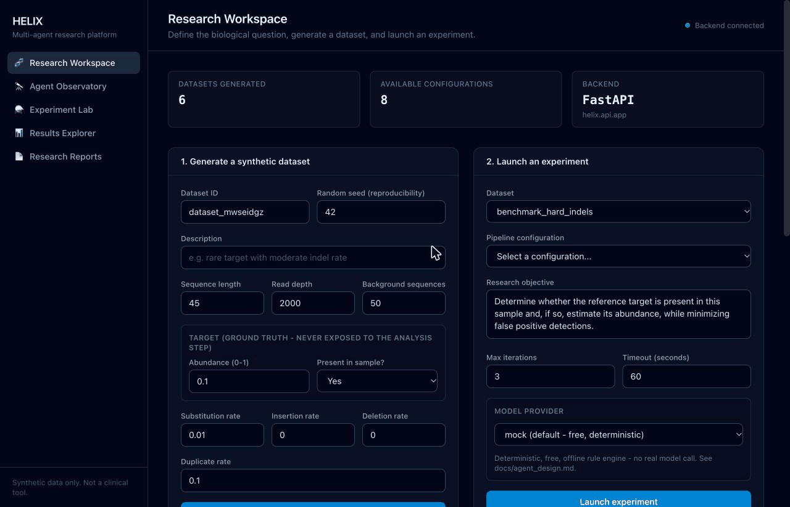
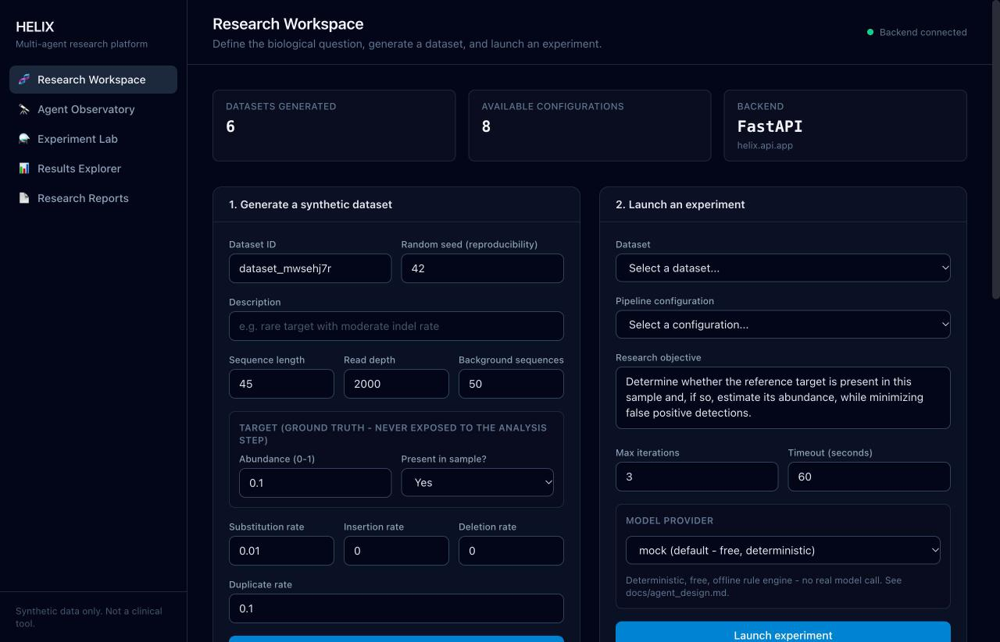
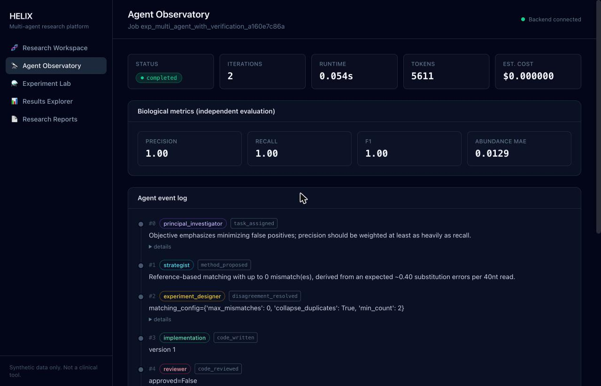
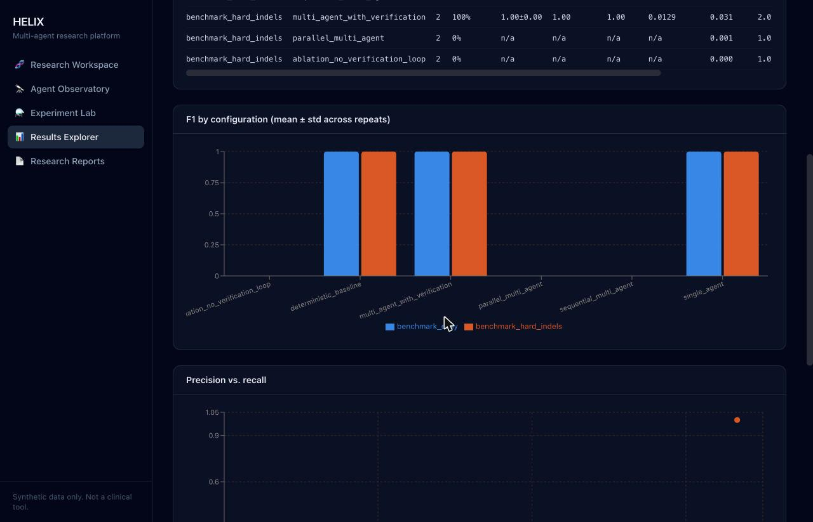
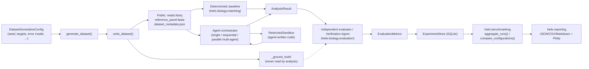

# HELIX

[](https://github.com/shrinjoy-c/helix/actions/workflows/tests.yml)
[](LICENSE)
[](pyproject.toml)

A reproducible multi-agent AI research platform for computational biology, investigating
scientific code generation, validation, and coordination through synthetic immune-repertoire
sequencing benchmarks.

**Status: Release 1.0 in progress (scientific core + agent orchestration + controlled
benchmark + API + dashboard).** This release implements a deterministic, ground-truth-backed
benchmark for synthetic TCR-like sequence detection; six specialized agents coordinated
through a shared, typed experiment state and a restricted code-execution sandbox;
single-agent, sequential multi-agent, parallel multi-agent, and ablation workflows; a
controlled benchmark runner with repeated-run statistics, significance testing, and
machine-readable/Plotly reports; a FastAPI backend over all of the above; a React +
TypeScript research dashboard; and a provider layer supporting Anthropic, Google Gemini, local
Ollama, and any OpenAI-compatible API (OpenAI, Groq, Together, DeepSeek, a self-hosted server,
...) behind one interface. Adaptive coordination is **not yet implemented** — see
[What's implemented vs. planned](#whats-implemented-vs-planned) below. Nothing in this
repository is a validated clinical tool; all sequence data is synthetic.

## Screenshots

**The full flow, live** — generating a dataset, launching a multi-agent experiment,
watching the Reviewer reject and then approve a revision, and a benchmark sweep's results
(all captured from a real local run, nothing staged):



**Research Workspace** — generate a synthetic dataset (with its ground truth kept
server-side only) and launch an experiment against any configured pipeline and provider:



**Agent Observatory** — the full typed event log of a multi-agent run, including the
Reviewer rejecting the Implementation Agent's first draft and requesting a revision:



**Results Explorer** — a controlled benchmark sweep across pipelines and datasets, with
repeated-run statistics. The `0%`/`n/a` rows are real: every configuration without a
revision loop (`sequential_multi_agent`, `parallel_multi_agent`,
`ablation_no_verification_loop`) fails outright in this run — see
[Limitations](#limitations) below for what that is and isn't evidence of:



## The research question

> When, why, and under what constraints do multi-agent AI systems improve the reliability and
> performance of computational biology workflows — compared with single-agent systems and
> conventional deterministic methods?

HELIX does not assume the answer is "yes." It is built to produce evidence that could show
multi-agent coordination helping, not helping, or helping only under specific data conditions.
See [`docs/research_questions.md`](docs/research_questions.md) for the five research questions
and five pre-registered hypotheses this project is investigating, and
[`docs/benchmark_methodology.md`](docs/benchmark_methodology.md) for exactly how the benchmark
is constructed and why.

## Why immune-repertoire sequencing

T-cell receptor (TCR) repertoire sequencing is a natural domain for this kind of benchmark: it
has real, well-understood failure modes (sequencing substitutions and indels, PCR duplicates,
rare targets buried in diverse backgrounds, near-identical decoy sequences) and a clear
ground-truth structure (a read either does or does not derive from a known target sequence).
All data used here is **fully synthetic** — generated with known ground truth, not sourced from
real patients — which is what makes it possible to score an analysis pipeline (deterministic or
agentic) objectively.

## Architecture (current)



Full module-by-module breakdown: [`docs/architecture.md`](docs/architecture.md).
Agent roles, coordination, and what's real vs. simulated: [`docs/agent_design.md`](docs/agent_design.md).
Execution sandbox's honest security scope: [`docs/security.md`](docs/security.md).
Ground-truth separation and determinism guarantees: [`docs/reproducibility.md`](docs/reproducibility.md).

## Installation

Requires Python 3.10+.

```bash
python3 -m venv .venv
source .venv/bin/activate
pip install -e ".[dev]"
# Optional, only to use a real model instead of the default deterministic MockProvider:
pip install -e ".[providers]"
```

## Running the tests

```bash
pytest -q
```

104 tests currently cover: deterministic dataset generation, FASTQ/FASTA round-tripping, the
matching baseline (exact matching, mismatch tolerance, duplicate collapsing, detection
thresholds), the independent evaluator (including the true-no-target case and a dataset-id
mismatch guard), experiment persistence (save/load round trip, idempotent upsert), agent
message validation and each agent's distinct operation, orchestration (single-agent, sequential
multi-agent, parallel multi-agent, ablations, iteration bounds, cancellation, timeout, recovery
from both reviewer rejection and execution failure), the execution sandbox (timeouts,
environment scrubbing, import blocking, ground-truth unreachability), the benchmarking
package (metric aggregation, statistical comparison, budget fairness across configurations,
sweep reproducibility, report/plot generation), and the FastAPI backend (dataset redaction,
background job polling, error handling for bad input). Runs in CI on every push
(`.github/workflows/tests.yml`).

## Running the API server

```bash
uvicorn helix.api.app:app --reload
```

Serves the same functionality the CLI scripts demonstrate, over HTTP (`/health`,
`/pipelines`, `/datasets`, `/experiments`, `/benchmarks`, `/jobs` - see
[`docs/architecture.md`](docs/architecture.md) for the full endpoint table). Interactive
API docs are auto-generated at `http://127.0.0.1:8000/docs`. Experiment and benchmark runs
are launched as background jobs and polled via `/jobs/{job_id}`, since a real model provider
run can take much longer than `MockProvider`'s milliseconds.

## Running the dashboard

```bash
cd frontend
npm install
npm run dev
```

Opens at `http://localhost:5173`, proxying API calls to the backend above (see
`frontend/README.md`). Five sections - Research Workspace (define objectives, generate
datasets, launch experiments), Agent Observatory (the real per-agent event log, rendered as a
timeline - reviewer rejections, disagreements, verification results, all from actual backend
data), Experiment Lab (configure and launch a benchmark sweep across any combination of the 8
configurations), Results Explorer (aggregated metrics table + charts), and Research Reports
(browse, inspect, and export full experiment records as JSON). Every page was exercised
end-to-end against a live backend before being called done - see
`docs/architecture.md`'s frontend section for exactly what was checked and the two real bugs
that check caught and fixed.

## Running the frontend tests

```bash
cd frontend
npm test
```

24 tests (Vitest + React Testing Library) covering the API client (`ApiError` on non-ok
responses, 204 handling, query-param construction), the categorical chart palette, the
status badge (every known experiment status, plus a graceful fallback for an unrecognized
one), and the provider selector's actual behavior - switching providers resets to that
provider's defaults and shows exactly the right fields (API key env for `gemini`/
`openai_compatible`, base URL for `ollama`/`openai_compatible`, neither for `mock`). Runs in
CI on every push, alongside a full `npm run build` to catch typecheck regressions.
Page-level tests (routing, TanStack Query data flow) are not yet covered - this is a first
slice, not the ceiling.

## Running the end-to-end demonstrations

```bash
python scripts/run_example_experiment.py
```

This generates three scenarios, each written to `datasets/generated/<id>/`, runs the
deterministic baseline against the *public* files only, independently evaluates against
ground truth loaded from a separate path, and persists an `ExperimentRecord` to
`experiments/results/helix.db`:

1. **`example_001_easy_moderate_target`** — a moderate-abundance target under a low error rate.
2. **`example_002_no_target_present`** — the reference panel is searched for but genuinely
   absent; the correct answer is "not detected," not a forced call.
3. **`example_003_hard_rare_target_with_confuser`** — a rare (1%) target under a higher error
   rate, plus a background sequence deliberately placed one nucleotide away from the target.

Representative output (your `runtime` and exact estimated frequencies will vary slightly run
to run if you change the seed, but are byte-identical for a fixed seed):

```
=== example_001_easy_moderate_target ===
predictions: [('target_a', True, 0.0452)]
precision=1.00 recall=1.00 f1=1.00 fp_rate=0.00 fn_rate=0.00 abundance_mae=0.0046

=== example_002_no_target_present ===
predictions: [('target_a', False, 0.0)]
precision=1.00 recall=1.00 f1=1.00 fp_rate=0.00 fn_rate=0.00 abundance_mae=None

=== example_003_hard_rare_target_with_confuser ===
predictions: [('target_a', True, 0.0362)]
precision=1.00 recall=1.00 f1=1.00 fp_rate=0.00 fn_rate=0.00 abundance_mae=0.0263
```

Scenario 3 is a genuine, informative baseline result, not a bug: the deterministic baseline's
presence/absence call is still correct, but its one-mismatch-tolerant matching gets partially
fooled by the deliberate near-match background confuser, inflating its abundance estimate
(true frequency ≈0.01, estimated ≈0.036). This is exactly the kind of failure mode the
benchmark is designed to surface, and the reason abundance error is tracked as a separate
metric from detection accuracy.

```bash
python scripts/run_agent_experiment.py
```

Runs the same synthetic dataset through both the single-agent and multi-agent workflows,
using the default, free, deterministic `MockProvider` (see
[`docs/agent_design.md`](docs/agent_design.md) for exactly what that provider does and does
not simulate), and prints each run's event log. Representative output:

```
=== Single-agent workflow ===
  [00]           single_agent | method_proposed      | Reference-based matching with up to 0 mismatch(es), ...
  [01]           single_agent | code_written         | version 1
  [02]           single_agent | code_executed        | success
  [03]               verifier | verification_run     | All acceptance criteria met.
  [04]           orchestrator | experiment_completed | status=completed after 1/3 iteration(s)
  status=completed iterations=1 precision=1.0 recall=1.0

=== Multi-agent workflow ===
  [00] principal_investigator | task_assigned        | Objective emphasizes minimizing false positives; ...
  [01]             strategist | method_proposed      | Reference-based matching with up to 0 mismatch(es), ...
  [02]    experiment_designer | disagreement_resolved | matching_config={'max_mismatches': 0, ...}
  [03]         implementation | code_written         | version 1
  [04]               reviewer | code_reviewed        | approved=False
  [05]               reviewer | revision_requested   | Reviewer rejected code; requesting revision.
  [06]         implementation | code_written         | version 2
  [07]               reviewer | code_reviewed        | approved=True
  [08]         implementation | code_executed        | success
  [09]               verifier | verification_run     | All acceptance criteria met.
  [10] principal_investigator | experiment_completed | Verification passed within 2/3 iteration(s); ...
  status=completed iterations=2 precision=1.0 recall=1.0
  Reviewer rejected 1/2 code version(s); issues: ['No evident handling of indel-shifted ... sequences; ...']
```

This is a real, reproducible example of the Reviewer catching something true about the
Implementation Agent's first code version (it only matches equal-length reads, so
insertion/deletion-affected reads are silently missed) and the Implementation Agent fixing it
on revision — demonstrated independently and deterministically in
`tests/test_agents.py::test_naive_code_misses_indel_shifted_read_but_revised_code_catches_it`,
not just asserted here. In this particular dataset's indel rate, the gap didn't end up changing
the final precision/recall (both workflows still detect the target correctly) — which is itself
an honest, useful observation: a code-quality defect a Reviewer should still catch does not
always show up as a metric regression in every dataset, which is part of why the benchmark
varies difficulty conditions rather than relying on one scenario.

```bash
python scripts/run_benchmark.py
```

Runs all eight configurations (deterministic baseline, single-agent, sequential multi-agent,
multi-agent with the full verification loop, parallel multi-agent, and three ablations)
against two datasets of different difficulty, 2 repeats each, under one shared resource
budget, then aggregates, writes a Markdown/JSON/CSV report, and generates Plotly comparison
charts to `experiments/results/benchmark_report/`. The headline (and honestly surprising)
result from this specific run: **every configuration that gets only one shot at the problem -
sequential multi-agent, parallel multi-agent, and the "remove the verification loop" ablation -
fails 100% of the time on both datasets**, while every configuration that retains a revision
cycle succeeds 100% of the time. This isn't a bug: under `MockProvider`'s policy the
Implementation Agent's first code draft never handles indel-shifted reads, the Reviewer
correctly rejects it every time, and only a revision cycle can fix it - a single-shot
configuration, however it explores the parameter space, never gets that second chance. See
[`docs/agent_design.md`](docs/agent_design.md) for the full writeup and the tests that prove
this is real, reproducible behavior rather than a flaky result.

## Using a real model provider

Every demo above uses the free, deterministic `MockProvider`. To use a real model, swap the
provider per-request (API: `"provider"` field; dashboard: the provider selector on the
Research Workspace / Experiment Lab) - no code or agent logic changes either way:

- **`anthropic`** - requires `ANTHROPIC_API_KEY` set on the server. Not yet run against a
  funded key (see Limitations).
- **`ollama`** - local, free, no API key. Requires `ollama serve` running and a model pulled
  (e.g. `ollama pull qwen3:4b`). This is genuinely tested, not just wired up: running real
  agent calls against a live `qwen3:4b` surfaced four real bugs, not zero - a reasoning model
  can burn its entire token budget on a `<think>` block and return empty content; the prompt
  never actually told the model the output schema's field names, so it invented
  plausible-but-wrong ones; a *fix* for that (embedding a concrete JSON example) backfired,
  with the model echoing the example back as its reply instead of the actual answer; and the
  model's context window defaulted smaller than the token budget being requested. All four are
  fixed in code. A short JSON-only call (`StrategistAgent.propose_approach`) reliably
  completes in well under a minute with a correctly-typed result, confirmed multiple times. A
  longer call (writing a full analysis script) has not yet been confirmed to complete within
  any tested timeout on the hardware this was developed on - recorded as an open item, not
  claimed as working. See `docs/agent_design.md`'s "Real providers" section for the full,
  honest story, including the backfired fix.
- **`openai_compatible`** - one provider for any OpenAI chat-completions-shaped API: OpenAI,
  Groq, Together, DeepSeek, Azure OpenAI, or a self-hosted vLLM/LM Studio server. Point
  `base_url` at the service and `api_key_env` at whichever environment variable on the server
  holds its key (e.g. `GROQ_API_KEY`) - never the raw key itself, which this API never accepts.
- **`gemini`** - requires `GEMINI_API_KEY` set on the server (get one at
  [aistudio.google.com/apikey](https://aistudio.google.com/apikey)). Implemented against
  Google's native Generative Language REST API, mocked-tested the same way Ollama/
  OpenAICompatible are, but - like `anthropic` - not yet run against a funded key. Treat it as
  implemented-but-unverified until a real run is recorded, the same honest status
  `AnthropicProvider` carried before its own live Ollama testing set the bar for what
  "verified" means here.

```bash
# Try it yourself, if you have `ollama serve` running:
python scripts/run_with_ollama.py          # defaults to qwen3:4b
python scripts/run_with_ollama.py llama3.1  # or any model you've pulled
```

## What's implemented vs. planned

| | Status |
|---|---|
| Configurable synthetic TCR-like dataset generator (errors, indels, duplicates, abundance, background diversity, near-match confusers, true-negative case) | ✅ Implemented |
| Deterministic, non-LLM matching baseline | ✅ Implemented |
| Independent ground-truth evaluator, kept separate from agent-visible data | ✅ Implemented |
| Structured experiment config/result persistence (SQLite) | ✅ Implemented |
| Six specialized agents (PI, Strategist, Implementation, Reviewer, Experiment Designer, Verifier) | ✅ Implemented |
| Shared typed `ExperimentState`, append-only event log, bounded iteration/timeout budgets, cancellation | ✅ Implemented |
| Restricted-subprocess execution sandbox for agent-written code | ✅ Implemented (not a hardened container — see `docs/security.md`) |
| Single-agent, sequential multi-agent, and parallel multi-agent workflows | ✅ Implemented |
| Ablations (remove Reviewer / Experiment Designer / revision loop, one at a time) | ✅ Implemented |
| Controlled benchmark sweep runner (dataset x configuration x repeat grid, shared budget) | ✅ Implemented |
| Repeated-run statistics (mean/std) + two-sample significance testing (SciPy) | ✅ Implemented |
| Machine-readable reports (JSON/CSV/Markdown) + Plotly comparison plots | ✅ Implemented |
| LLM provider layer: `MockProvider` (default, deterministic) + `AnthropicProvider` + `GeminiProvider` + `OllamaProvider` + `OpenAICompatibleProvider` (OpenAI/Groq/Together/DeepSeek/self-hosted/...) | ✅ Implemented - `Ollama`/`OpenAICompatible` verified against a live local model; `AnthropicProvider`/`GeminiProvider` still not run against a funded key |
| FastAPI backend (dataset generation, experiment/benchmark launch, job polling, per-request provider selection) | ✅ Implemented |
| Unit + integration tests (135 passing), CI on every push | ✅ Implemented |
| Hard-enforced per-run token/cost budget cutoff | ✅ Implemented (`max_tokens`/`max_cost_usd`, checked after every agent call in the revision loop - see `docs/agent_design.md`) |
| Adaptive agent coordination | ⏳ Planned (major extension, after the controlled benchmark is exercised more broadly) |
| React + TypeScript research dashboard (`frontend/`) | ✅ Implemented |
| Job/dataset-config registry surviving API server restarts (SQLite-backed) | ✅ Implemented |
| Automated frontend test suite | ✅ Implemented (Vitest + React Testing Library, 24 tests, CI on every push) |

## Limitations

- Sequences are opaque nucleotide strings standing in for CDR3 regions — there is no V(D)J
  recombination model, no translation, and no attempt at biologically faithful germline gene
  usage.
- Sequencing errors are i.i.d. per-base, not the position/context-dependent profiles of real
  instruments.
- The deterministic baseline's matching is a simple, auditable reference implementation
  (Hamming/bounded-edit-distance with a mismatch threshold) — not a production repertoire
  aligner, and not claimed to be state of the art.
- No claims of superiority (agentic over deterministic, or multi-agent over single-agent) are
  made anywhere in this repository. The one benchmark sweep run so far (two datasets, 2
  repeats, `MockProvider`) found no accuracy difference between single-agent, multi-agent, and
  the deterministic baseline — it did find that configurations without any revision loop fail
  outright. That is a real, narrow, reproducible result, not a general claim about agentic vs.
  deterministic or single- vs. multi-agent approaches — see `docs/research_questions.md` for
  exactly what is and isn't supported so far.
- Token/cost budgets (`max_tokens`/`max_cost_usd`) are hard-enforced, not just tracked, but
  off by default everywhere (orchestrator, API, benchmark sweeps, and the dashboard forms) —
  a run that doesn't set them explicitly gets unbounded usage, same as before this existed.
  See `docs/agent_design.md`'s "Hard-enforced token/cost budgets".
- The execution sandbox is a restricted subprocess, not a hardened container — see
  `docs/security.md` for exactly what it does and does not protect against.
- The default `MockProvider` is a deterministic rule engine standing in for a language model,
  not a simulation of one; its revision policy is narrow (see `docs/agent_design.md`).
- `AnthropicProvider` and `GeminiProvider` still have not been run against a funded key.
  `OllamaProvider`'s HTTP layer and short JSON-only calls (e.g.
  `StrategistAgent.propose_approach`) are confirmed working against a live local model
  (`qwen3:4b`) - that testing is what found the four bugs above. A full agent run that
  includes code-generation-length output has not yet been confirmed to complete on the
  hardware this was developed on (see `docs/agent_design.md`); only one local model has been
  tried at all, so a broader sweep may surface more. `GeminiProvider`'s REST contract and
  response parsing are implemented against Google's published API docs and covered by mocked
  tests, the same way `OllamaProvider`/`OpenAICompatibleProvider` were before their own live
  testing - the honest status is "should work," not "confirmed working."
- `OpenAICompatibleProvider`'s cost estimation is `$0.0` ("unknown") unless you supply
  `pricing_per_million_tokens` yourself - there is no way to know a hosted price for an
  arbitrary `base_url` in general.

See [`docs/benchmark_methodology.md`](docs/benchmark_methodology.md) and
[`docs/agent_design.md`](docs/agent_design.md) for the full list of simplifying assumptions and
why each was made.

## Repository layout

```
src/helix/
  config/models.py        # Pydantic models shared across every module
  biology/
    sequences.py           # seeded mutation, near-match construction, distance functions
    simulation.py           # dataset generator + public/ground-truth file writer
    matching.py              # deterministic baseline
    evaluation.py             # independent ground-truth evaluator
  io/fastq.py              # Biopython-backed FASTQ/FASTA I/O
  experiments/store.py     # SQLite experiment persistence
  providers/               # LLMProvider interface: MockProvider, AnthropicProvider
  agents/                  # PI, Strategist, Implementation, Reviewer, Experiment Designer, Verifier
  orchestration/           # messages, ExperimentState, event log, scheduler, orchestrator
  execution/               # RestrictedSandbox + runner bridging agent code to it
  benchmarking/            # PipelineSpec/run_pipeline dispatcher, ablations, sweep runner, metric aggregation
  reporting/               # JSON/CSV/Markdown reports, Plotly comparison plots
  api/                     # FastAPI backend: app.py, jobs.py, registry.py, schemas.py
scripts/
  run_example_experiment.py   # deterministic-baseline end-to-end demonstration
  run_agent_experiment.py     # single-agent / multi-agent end-to-end demonstration
  run_benchmark.py            # full controlled-benchmark sweep + report
tests/                     # pytest suite (104 tests)
docs/                      # architecture, research questions, methodology, agent design, security, reproducibility
datasets/generated/        # generated datasets (gitignored contents, directory tracked)
experiments/results/       # SQLite experiment database + benchmark_report/ (gitignored)
.github/workflows/         # CI: pytest on every push, Python 3.10 and 3.12
frontend/                  # React + TypeScript + Tailwind dashboard (see frontend/README.md)
  src/api/                  # client.ts, types.ts (mirrors the backend's Pydantic schemas)
  src/hooks/                # TanStack Query hooks - all data fetching goes through these
  src/pages/                # Research Workspace, Agent Observatory, Experiment Lab, Results Explorer, Research Reports
```

## Citation

See [`CITATION.cff`](CITATION.cff).

## License

MIT — see [`LICENSE`](LICENSE).
