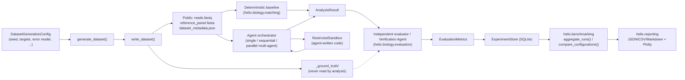

# HELIX

A reproducible multi-agent AI research platform for computational biology, investigating
scientific code generation, validation, and coordination through synthetic immune-repertoire
sequencing benchmarks.

**Status: Release 0.5 (scientific core + agent orchestration + controlled benchmark).** This
release implements a deterministic, ground-truth-backed benchmark for synthetic TCR-like
sequence detection; six specialized agents coordinated through a shared, typed experiment
state and a restricted code-execution sandbox; single-agent, sequential multi-agent, parallel
multi-agent, and ablation workflows; and a controlled benchmark runner with repeated-run
statistics, significance testing, and machine-readable/Plotly reports. The LLM provider layer
beyond Anthropic, adaptive coordination, and the frontend are **not yet implemented** — see
[What's implemented vs. planned](#whats-implemented-vs-planned) below. Nothing in this
repository is a validated clinical tool; all sequence data is synthetic.

## The research question

> When, why, and under what constraints do multi-agent AI systems improve the reliability and
> performance of computational biology workflows — compared with single-agent systems and
> conventional deterministic methods?

HELIX does not assume the answer is "yes." It is built to produce evidence that could show
multi-agent coordination helping, not helping, or helping only under specific data conditions.
See [`docs/research_questions.md`](docs/research_questions.md) for the five research questions
and five pre-registered hypotheses this project is investigating, and
[`docs/benchmark_methodology.md`](docs/benchmark_methodology.md) for exactly how the benchmark
is constructed and why.

## Why immune-repertoire sequencing

T-cell receptor (TCR) repertoire sequencing is a natural domain for this kind of benchmark: it
has real, well-understood failure modes (sequencing substitutions and indels, PCR duplicates,
rare targets buried in diverse backgrounds, near-identical decoy sequences) and a clear
ground-truth structure (a read either does or does not derive from a known target sequence).
All data used here is **fully synthetic** — generated with known ground truth, not sourced from
real patients — which is what makes it possible to score an analysis pipeline (deterministic or
agentic) objectively.

## Architecture (current)



Full module-by-module breakdown: [`docs/architecture.md`](docs/architecture.md).
Agent roles, coordination, and what's real vs. simulated: [`docs/agent_design.md`](docs/agent_design.md).
Execution sandbox's honest security scope: [`docs/security.md`](docs/security.md).
Ground-truth separation and determinism guarantees: [`docs/reproducibility.md`](docs/reproducibility.md).

## Installation

Requires Python 3.10+.

```bash
python3 -m venv .venv
source .venv/bin/activate
pip install -e ".[dev]"
# Optional, only to use a real model instead of the default deterministic MockProvider:
pip install -e ".[providers]"
```

## Running the tests

```bash
pytest -q
```

89 tests currently cover: deterministic dataset generation, FASTQ/FASTA round-tripping, the
matching baseline (exact matching, mismatch tolerance, duplicate collapsing, detection
thresholds), the independent evaluator (including the true-no-target case and a dataset-id
mismatch guard), experiment persistence (save/load round trip, idempotent upsert), agent
message validation and each agent's distinct operation, orchestration (single-agent, sequential
multi-agent, parallel multi-agent, ablations, iteration bounds, cancellation, timeout, recovery
from both reviewer rejection and execution failure), the execution sandbox (timeouts,
environment scrubbing, import blocking, ground-truth unreachability), and the benchmarking
package (metric aggregation, statistical comparison, budget fairness across configurations,
sweep reproducibility, report/plot generation). Runs in CI on every push
(`.github/workflows/tests.yml`).

## Running the end-to-end demonstrations

```bash
python scripts/run_example_experiment.py
```

This generates three scenarios, each written to `datasets/generated/<id>/`, runs the
deterministic baseline against the *public* files only, independently evaluates against
ground truth loaded from a separate path, and persists an `ExperimentRecord` to
`experiments/results/helix.db`:

1. **`example_001_easy_moderate_target`** — a moderate-abundance target under a low error rate.
2. **`example_002_no_target_present`** — the reference panel is searched for but genuinely
   absent; the correct answer is "not detected," not a forced call.
3. **`example_003_hard_rare_target_with_confuser`** — a rare (1%) target under a higher error
   rate, plus a background sequence deliberately placed one nucleotide away from the target.

Representative output (your `runtime` and exact estimated frequencies will vary slightly run
to run if you change the seed, but are byte-identical for a fixed seed):

```
=== example_001_easy_moderate_target ===
predictions: [('target_a', True, 0.0452)]
precision=1.00 recall=1.00 f1=1.00 fp_rate=0.00 fn_rate=0.00 abundance_mae=0.0046

=== example_002_no_target_present ===
predictions: [('target_a', False, 0.0)]
precision=1.00 recall=1.00 f1=1.00 fp_rate=0.00 fn_rate=0.00 abundance_mae=None

=== example_003_hard_rare_target_with_confuser ===
predictions: [('target_a', True, 0.0362)]
precision=1.00 recall=1.00 f1=1.00 fp_rate=0.00 fn_rate=0.00 abundance_mae=0.0263
```

Scenario 3 is a genuine, informative baseline result, not a bug: the deterministic baseline's
presence/absence call is still correct, but its one-mismatch-tolerant matching gets partially
fooled by the deliberate near-match background confuser, inflating its abundance estimate
(true frequency ≈0.01, estimated ≈0.036). This is exactly the kind of failure mode the
benchmark is designed to surface, and the reason abundance error is tracked as a separate
metric from detection accuracy.

```bash
python scripts/run_agent_experiment.py
```

Runs the same synthetic dataset through both the single-agent and multi-agent workflows,
using the default, free, deterministic `MockProvider` (see
[`docs/agent_design.md`](docs/agent_design.md) for exactly what that provider does and does
not simulate), and prints each run's event log. Representative output:

```
=== Single-agent workflow ===
  [00]           single_agent | method_proposed      | Reference-based matching with up to 0 mismatch(es), ...
  [01]           single_agent | code_written         | version 1
  [02]           single_agent | code_executed        | success
  [03]               verifier | verification_run     | All acceptance criteria met.
  [04]           orchestrator | experiment_completed | status=completed after 1/3 iteration(s)
  status=completed iterations=1 precision=1.0 recall=1.0

=== Multi-agent workflow ===
  [00] principal_investigator | task_assigned        | Objective emphasizes minimizing false positives; ...
  [01]             strategist | method_proposed      | Reference-based matching with up to 0 mismatch(es), ...
  [02]    experiment_designer | disagreement_resolved | matching_config={'max_mismatches': 0, ...}
  [03]         implementation | code_written         | version 1
  [04]               reviewer | code_reviewed        | approved=False
  [05]               reviewer | revision_requested   | Reviewer rejected code; requesting revision.
  [06]         implementation | code_written         | version 2
  [07]               reviewer | code_reviewed        | approved=True
  [08]         implementation | code_executed        | success
  [09]               verifier | verification_run     | All acceptance criteria met.
  [10] principal_investigator | experiment_completed | Verification passed within 2/3 iteration(s); ...
  status=completed iterations=2 precision=1.0 recall=1.0
  Reviewer rejected 1/2 code version(s); issues: ['No evident handling of indel-shifted ... sequences; ...']
```

This is a real, reproducible example of the Reviewer catching something true about the
Implementation Agent's first code version (it only matches equal-length reads, so
insertion/deletion-affected reads are silently missed) and the Implementation Agent fixing it
on revision — demonstrated independently and deterministically in
`tests/test_agents.py::test_naive_code_misses_indel_shifted_read_but_revised_code_catches_it`,
not just asserted here. In this particular dataset's indel rate, the gap didn't end up changing
the final precision/recall (both workflows still detect the target correctly) — which is itself
an honest, useful observation: a code-quality defect a Reviewer should still catch does not
always show up as a metric regression in every dataset, which is part of why the benchmark
varies difficulty conditions rather than relying on one scenario.

```bash
python scripts/run_benchmark.py
```

Runs all eight configurations (deterministic baseline, single-agent, sequential multi-agent,
multi-agent with the full verification loop, parallel multi-agent, and three ablations)
against two datasets of different difficulty, 2 repeats each, under one shared resource
budget, then aggregates, writes a Markdown/JSON/CSV report, and generates Plotly comparison
charts to `experiments/results/benchmark_report/`. The headline (and honestly surprising)
result from this specific run: **every configuration that gets only one shot at the problem -
sequential multi-agent, parallel multi-agent, and the "remove the verification loop" ablation -
fails 100% of the time on both datasets**, while every configuration that retains a revision
cycle succeeds 100% of the time. This isn't a bug: under `MockProvider`'s policy the
Implementation Agent's first code draft never handles indel-shifted reads, the Reviewer
correctly rejects it every time, and only a revision cycle can fix it - a single-shot
configuration, however it explores the parameter space, never gets that second chance. See
[`docs/agent_design.md`](docs/agent_design.md) for the full writeup and the tests that prove
this is real, reproducible behavior rather than a flaky result.

## What's implemented vs. planned

| | Status |
|---|---|
| Configurable synthetic TCR-like dataset generator (errors, indels, duplicates, abundance, background diversity, near-match confusers, true-negative case) | ✅ Implemented |
| Deterministic, non-LLM matching baseline | ✅ Implemented |
| Independent ground-truth evaluator, kept separate from agent-visible data | ✅ Implemented |
| Structured experiment config/result persistence (SQLite) | ✅ Implemented |
| Six specialized agents (PI, Strategist, Implementation, Reviewer, Experiment Designer, Verifier) | ✅ Implemented |
| Shared typed `ExperimentState`, append-only event log, bounded iteration/timeout budgets, cancellation | ✅ Implemented |
| Restricted-subprocess execution sandbox for agent-written code | ✅ Implemented (not a hardened container — see `docs/security.md`) |
| Single-agent, sequential multi-agent, and parallel multi-agent workflows | ✅ Implemented |
| Ablations (remove Reviewer / Experiment Designer / revision loop, one at a time) | ✅ Implemented |
| Controlled benchmark sweep runner (dataset x configuration x repeat grid, shared budget) | ✅ Implemented |
| Repeated-run statistics (mean/std) + two-sample significance testing (SciPy) | ✅ Implemented |
| Machine-readable reports (JSON/CSV/Markdown) + Plotly comparison plots | ✅ Implemented |
| LLM provider layer: deterministic `MockProvider` (default) + `AnthropicProvider` | ✅ Implemented (`AnthropicProvider` not yet run against a funded API key) |
| Unit + integration tests (89 passing), CI on every push | ✅ Implemented |
| OpenAI-compatible / Gemini / Ollama providers | ⏳ Planned |
| Hard-enforced per-run token/cost budget cutoff (currently tracked, not capped) | ⏳ Planned |
| Adaptive agent coordination | ⏳ Planned (major extension, after the controlled benchmark is exercised more broadly) |
| FastAPI backend / React + TypeScript frontend | ⏳ Planned |

## Limitations

- Sequences are opaque nucleotide strings standing in for CDR3 regions — there is no V(D)J
  recombination model, no translation, and no attempt at biologically faithful germline gene
  usage.
- Sequencing errors are i.i.d. per-base, not the position/context-dependent profiles of real
  instruments.
- The deterministic baseline's matching is a simple, auditable reference implementation
  (Hamming/bounded-edit-distance with a mismatch threshold) — not a production repertoire
  aligner, and not claimed to be state of the art.
- No claims of superiority (agentic over deterministic, or multi-agent over single-agent) are
  made anywhere in this repository. The one benchmark sweep run so far (two datasets, 2
  repeats, `MockProvider`) found no accuracy difference between single-agent, multi-agent, and
  the deterministic baseline — it did find that configurations without any revision loop fail
  outright. That is a real, narrow, reproducible result, not a general claim about agentic vs.
  deterministic or single- vs. multi-agent approaches — see `docs/research_questions.md` for
  exactly what is and isn't supported so far.
- Token/cost budgets are tracked per run but not yet a hard mid-run cutoff — see
  `docs/benchmark_methodology.md`'s Known Limitations.
- The execution sandbox is a restricted subprocess, not a hardened container — see
  `docs/security.md` for exactly what it does and does not protect against.
- The default `MockProvider` is a deterministic rule engine standing in for a language model,
  not a simulation of one; its revision policy is narrow (see `docs/agent_design.md`).

See [`docs/benchmark_methodology.md`](docs/benchmark_methodology.md) and
[`docs/agent_design.md`](docs/agent_design.md) for the full list of simplifying assumptions and
why each was made.

## Repository layout

```
src/helix/
  config/models.py        # Pydantic models shared across every module
  biology/
    sequences.py           # seeded mutation, near-match construction, distance functions
    simulation.py           # dataset generator + public/ground-truth file writer
    matching.py              # deterministic baseline
    evaluation.py             # independent ground-truth evaluator
  io/fastq.py              # Biopython-backed FASTQ/FASTA I/O
  experiments/store.py     # SQLite experiment persistence
  providers/               # LLMProvider interface: MockProvider, AnthropicProvider
  agents/                  # PI, Strategist, Implementation, Reviewer, Experiment Designer, Verifier
  orchestration/           # messages, ExperimentState, event log, scheduler, orchestrator
  execution/               # RestrictedSandbox + runner bridging agent code to it
  benchmarking/            # PipelineSpec/run_pipeline dispatcher, ablations, sweep runner, metric aggregation
  reporting/               # JSON/CSV/Markdown reports, Plotly comparison plots
scripts/
  run_example_experiment.py   # deterministic-baseline end-to-end demonstration
  run_agent_experiment.py     # single-agent / multi-agent end-to-end demonstration
  run_benchmark.py            # full controlled-benchmark sweep + report
tests/                     # pytest suite (89 tests)
docs/                      # architecture, research questions, methodology, agent design, security, reproducibility
datasets/generated/        # generated datasets (gitignored contents, directory tracked)
experiments/results/       # SQLite experiment database + benchmark_report/ (gitignored)
.github/workflows/         # CI: pytest on every push, Python 3.10 and 3.12
```

## Citation

See [`CITATION.cff`](CITATION.cff).

## License

MIT — see [`LICENSE`](LICENSE).
