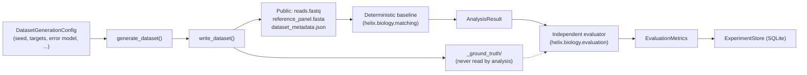

# HELIX

A reproducible multi-agent AI research platform for computational biology, investigating
scientific code generation, validation, and coordination through synthetic immune-repertoire
sequencing benchmarks.

**Status: Release 0.1 (scientific core).** This release implements a deterministic,
ground-truth-backed benchmark for synthetic TCR-like sequence detection: a configurable
dataset generator, a non-LLM matching baseline, an independent evaluator, and experiment
persistence. Agent orchestration, LLM provider integrations, the sandboxed execution
environment, the controlled benchmark runner, and the frontend are **not yet implemented** —
see [What's implemented vs. planned](#whats-implemented-vs-planned) below. Nothing in this
repository is a validated clinical tool; all sequence data is synthetic.

## The research question

> When, why, and under what constraints do multi-agent AI systems improve the reliability and
> performance of computational biology workflows — compared with single-agent systems and
> conventional deterministic methods?

HELIX does not assume the answer is "yes." It is built to produce evidence that could show
multi-agent coordination helping, not helping, or helping only under specific data conditions.
See [`docs/research_questions.md`](docs/research_questions.md) for the five research questions
and five pre-registered hypotheses this project is investigating, and
[`docs/benchmark_methodology.md`](docs/benchmark_methodology.md) for exactly how the benchmark
is constructed and why.

## Why immune-repertoire sequencing

T-cell receptor (TCR) repertoire sequencing is a natural domain for this kind of benchmark: it
has real, well-understood failure modes (sequencing substitutions and indels, PCR duplicates,
rare targets buried in diverse backgrounds, near-identical decoy sequences) and a clear
ground-truth structure (a read either does or does not derive from a known target sequence).
All data used here is **fully synthetic** — generated with known ground truth, not sourced from
real patients — which is what makes it possible to score an analysis pipeline (deterministic or
agentic) objectively.

## Architecture (current)



Full module-by-module breakdown: [`docs/architecture.md`](docs/architecture.md).
Ground-truth separation and determinism guarantees: [`docs/reproducibility.md`](docs/reproducibility.md).

## Installation

Requires Python 3.10+.

```bash
python3 -m venv .venv
source .venv/bin/activate
pip install -e ".[dev]"
```

## Running the tests

```bash
pytest -q
```

29 tests currently cover: deterministic generation, FASTQ/FASTA round-tripping, the matching
baseline (exact matching, mismatch tolerance, duplicate collapsing, detection thresholds), the
independent evaluator (including the true-no-target case and a dataset-id mismatch guard), and
experiment persistence (save/load round trip, idempotent upsert).

## Running the end-to-end demonstration

```bash
python scripts/run_example_experiment.py
```

This generates three scenarios, each written to `datasets/generated/<id>/`, runs the
deterministic baseline against the *public* files only, independently evaluates against
ground truth loaded from a separate path, and persists an `ExperimentRecord` to
`experiments/results/helix.db`:

1. **`example_001_easy_moderate_target`** — a moderate-abundance target under a low error rate.
2. **`example_002_no_target_present`** — the reference panel is searched for but genuinely
   absent; the correct answer is "not detected," not a forced call.
3. **`example_003_hard_rare_target_with_confuser`** — a rare (1%) target under a higher error
   rate, plus a background sequence deliberately placed one nucleotide away from the target.

Representative output (your `runtime` and exact estimated frequencies will vary slightly run
to run if you change the seed, but are byte-identical for a fixed seed):

```
=== example_001_easy_moderate_target ===
predictions: [('target_a', True, 0.0452)]
precision=1.00 recall=1.00 f1=1.00 fp_rate=0.00 fn_rate=0.00 abundance_mae=0.0046

=== example_002_no_target_present ===
predictions: [('target_a', False, 0.0)]
precision=1.00 recall=1.00 f1=1.00 fp_rate=0.00 fn_rate=0.00 abundance_mae=None

=== example_003_hard_rare_target_with_confuser ===
predictions: [('target_a', True, 0.0362)]
precision=1.00 recall=1.00 f1=1.00 fp_rate=0.00 fn_rate=0.00 abundance_mae=0.0263
```

Scenario 3 is a genuine, informative baseline result, not a bug: the deterministic baseline's
presence/absence call is still correct, but its one-mismatch-tolerant matching gets partially
fooled by the deliberate near-match background confuser, inflating its abundance estimate
(true frequency ≈0.01, estimated ≈0.036). This is exactly the kind of failure mode the
benchmark is designed to surface, and the reason abundance error is tracked as a separate
metric from detection accuracy.

## What's implemented vs. planned

| | Status |
|---|---|
| Configurable synthetic TCR-like dataset generator (errors, indels, duplicates, abundance, background diversity, near-match confusers, true-negative case) | ✅ Implemented |
| Deterministic, non-LLM matching baseline | ✅ Implemented |
| Independent ground-truth evaluator, kept separate from agent-visible data | ✅ Implemented |
| Structured experiment config/result persistence (SQLite) | ✅ Implemented |
| Unit + integration tests (29 passing) | ✅ Implemented |
| Six specialized agents (PI, Strategist, Implementation, Reviewer, Experiment Designer, Verifier) | ⏳ Planned, next phase |
| Sandboxed execution for agent-written code | ⏳ Planned |
| LLM provider layer (Anthropic / OpenAI-compatible / Gemini / Ollama) | ⏳ Planned |
| Controlled multi-configuration benchmark + ablations + repeated-run statistics | ⏳ Planned |
| Adaptive agent coordination | ⏳ Planned (major extension, after the core benchmark works) |
| FastAPI backend / React + TypeScript frontend | ⏳ Planned |
| CI (GitHub Actions running tests on push) | ⏳ Planned |

## Limitations

- Sequences are opaque nucleotide strings standing in for CDR3 regions — there is no V(D)J
  recombination model, no translation, and no attempt at biologically faithful germline gene
  usage.
- Sequencing errors are i.i.d. per-base, not the position/context-dependent profiles of real
  instruments.
- The deterministic baseline's matching is a simple, auditable reference implementation
  (Hamming/bounded-edit-distance with a mismatch threshold) — not a production repertoire
  aligner, and not claimed to be state of the art.
- No claims of superiority (agentic over deterministic, or multi-agent over single-agent) are
  made anywhere in this repository, because no such experiment has been run yet.

See [`docs/benchmark_methodology.md`](docs/benchmark_methodology.md) for the full list of
simplifying assumptions and why each was made.

## Repository layout

```
src/helix/
  config/models.py      # Pydantic models shared across every module
  biology/
    sequences.py         # seeded mutation, near-match construction, distance functions
    simulation.py         # dataset generator + public/ground-truth file writer
    matching.py            # deterministic baseline
    evaluation.py           # independent ground-truth evaluator
  io/fastq.py            # Biopython-backed FASTQ/FASTA I/O
  experiments/store.py   # SQLite experiment persistence
scripts/run_example_experiment.py   # end-to-end demonstration
tests/                   # pytest suite
docs/                    # architecture, research questions, methodology, reproducibility
datasets/generated/      # generated datasets (gitignored contents, directory tracked)
experiments/results/     # SQLite experiment database (gitignored)
```

## Citation

See [`CITATION.cff`](CITATION.cff).

## License

MIT — see [`LICENSE`](LICENSE).
