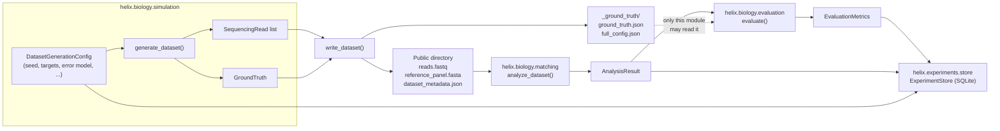

# HELIX Architecture

This document describes the system as it actually exists, and separates that clearly from
what is planned for later releases. See `docs/research_questions.md` for the scientific
motivation and `docs/benchmark_methodology.md` for how the benchmark is constructed.

## Status (Release 0.1)

| Component | Status |
|---|---|
| Synthetic dataset generator (`helix.biology.simulation`) | **Implemented** |
| Sequence mutation / distance utilities (`helix.biology.sequences`) | **Implemented** |
| FASTQ/FASTA I/O (`helix.io.fastq`) | **Implemented** |
| Deterministic matching baseline (`helix.biology.matching`) | **Implemented** |
| Independent ground-truth evaluator (`helix.biology.evaluation`) | **Implemented** |
| Experiment persistence (`helix.experiments.store`, SQLite) | **Implemented** |
| Pydantic config/result models (`helix.config.models`) | **Implemented** |
| Agent orchestration (PI, Strategist, Implementation, Reviewer, Experiment Designer, Verifier) | Not yet built |
| Sandboxed code execution for agent-written code | Not yet built |
| LLM provider layer (Anthropic / OpenAI-compatible / Ollama) | Not yet built |
| Controlled benchmark runner, ablations, repeated-run statistics | Not yet built |
| FastAPI backend / React frontend | Not yet built |

## Data flow (Release 0.1)

The arrow from `_ground_truth/` to the evaluator is intentionally the *only* path into that
directory anywhere in the codebase. `analyze_dataset()` takes a directory path and only ever
opens `reads.fastq` and `reference_panel.fasta` from it — it has no code path that could reach
`_ground_truth/`. This is an API-level and directory-level separation, not (yet) a hard
process/filesystem sandbox; that hardening is planned for the agent-execution phase, where
untrusted, model-generated code needs it far more than this trusted deterministic baseline does.

## Module responsibilities

- **`helix.config.models`** — every cross-module interface is a Pydantic model: generation
  config, reads, ground truth, matching config, analysis results, evaluation metrics, and the
  persisted experiment record. Nothing passes through the system as a loose dict.
- **`helix.biology.sequences`** — pure functions: random sequence generation, i.i.d.
  substitution/insertion/deletion mutation, Hamming and bounded edit distance, near-match
  variant construction (for building deliberately hard cases).
- **`helix.biology.simulation`** — turns a `DatasetGenerationConfig` into reads + ground truth
  deterministically (seeded `numpy.random.Generator`), and writes the public/private file split
  described above.
- **`helix.io.fastq`** — Biopython-backed FASTQ/FASTA read and write.
- **`helix.biology.matching`** — the conventional, non-LLM baseline: barcode-based duplicate
  collapsing, distance-based reference matching, frequency estimation, threshold-based detection.
- **`helix.biology.evaluation`** — the only module allowed to load a `GroundTruth`; scores a
  previously-produced `AnalysisResult` against it with fixed metric formulas.
- **`helix.experiments.store`** — SQLite-backed persistence of `ExperimentRecord`s, keyed so
  that every stored experiment can be reproduced from its saved `dataset_config` alone.

## Why no agents yet

Per the project's own phased roadmap, Release 0.1's scientific core (generator, deterministic
baseline, independent evaluator, persistence) has to exist and be trustworthy *before* agent
orchestration is layered on top of it — otherwise there is no reliable ground truth against
which to measure whether agents help. The next phase builds the six specialized agents
(Principal Investigator, Strategist, Implementation, Independent Reviewer, Experiment
Designer, Independent Verification) as distinct modules against this same set of models and
the same evaluator, so that single-agent and multi-agent runs are scored identically to the
deterministic baseline above.
