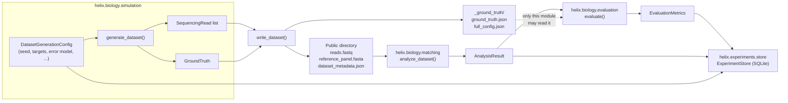
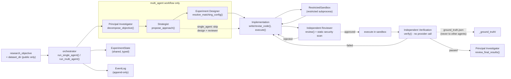

# HELIX Architecture

This document describes the system as it actually exists, and separates that clearly from
what is planned for later releases. See `docs/research_questions.md` for the scientific
motivation and `docs/benchmark_methodology.md` for how the benchmark is constructed.

## Status (Release 0.1)

| Component | Status |
|---|---|
| Synthetic dataset generator (`helix.biology.simulation`) | **Implemented** |
| Sequence mutation / distance utilities (`helix.biology.sequences`) | **Implemented** |
| FASTQ/FASTA I/O (`helix.io.fastq`) | **Implemented** |
| Deterministic matching baseline (`helix.biology.matching`) | **Implemented** |
| Independent ground-truth evaluator (`helix.biology.evaluation`) | **Implemented** |
| Experiment persistence (`helix.experiments.store`, SQLite) | **Implemented** |
| Pydantic config/result models (`helix.config.models`) | **Implemented** |
| Agent orchestration: PI, Strategist, Implementation, Reviewer, Experiment Designer, Verifier | **Implemented** |
| Shared `ExperimentState`, append-only event log, iteration/timeout budgets, cancellation | **Implemented** |
| Restricted-subprocess code execution for agent-written code | **Implemented** (not a hardened container - see `docs/security.md`) |
| Single-agent and multi-agent workflows | **Implemented** |
| LLM provider layer: `MockProvider` (default) + `AnthropicProvider` + `GeminiProvider` + `OllamaProvider` + `OpenAICompatibleProvider` | **Implemented** - Ollama/OpenAICompatible verified against a live local model (see `docs/agent_design.md`'s "Real providers" section); Anthropic/Gemini still not run against a funded key |
| Parallel multi-agent workflow (`run_parallel_multi_agent`) | **Implemented** (one round, no cross-round revision - see `docs/agent_design.md`) |
| Ablations (remove Reviewer / Experiment Designer / revision loop) | **Implemented** |
| Controlled benchmark sweep runner, repeated-run statistics, significance testing | **Implemented** (`helix.benchmarking`) |
| Machine-readable reports + Plotly comparison plots | **Implemented** (`helix.reporting`) |
| FastAPI backend (`helix.api`) | **Implemented** |
| React + TypeScript frontend (`frontend/`) | **Implemented** |
| CI (GitHub Actions) | **Implemented** (`.github/workflows/tests.yml`) |

## Data flow (Release 0.1)

The arrow from `_ground_truth/` to the evaluator is intentionally the *only* path into that
directory anywhere in the codebase. `analyze_dataset()` takes a directory path and only ever
opens `reads.fastq` and `reference_panel.fasta` from it — it has no code path that could reach
`_ground_truth/`. This is an API-level and directory-level separation, not (yet) a hard
process/filesystem sandbox; that hardening is planned for the agent-execution phase, where
untrusted, model-generated code needs it far more than this trusted deterministic baseline does.

## Module responsibilities

- **`helix.config.models`** — every cross-module interface is a Pydantic model: generation
  config, reads, ground truth, matching config, analysis results, evaluation metrics, and the
  persisted experiment record. Nothing passes through the system as a loose dict.
- **`helix.biology.sequences`** — pure functions: random sequence generation, i.i.d.
  substitution/insertion/deletion mutation, Hamming and bounded edit distance, near-match
  variant construction (for building deliberately hard cases).
- **`helix.biology.simulation`** — turns a `DatasetGenerationConfig` into reads + ground truth
  deterministically (seeded `numpy.random.Generator`), and writes the public/private file split
  described above.
- **`helix.io.fastq`** — Biopython-backed FASTQ/FASTA read and write.
- **`helix.biology.matching`** — the conventional, non-LLM baseline: barcode-based duplicate
  collapsing, distance-based reference matching, frequency estimation, threshold-based detection.
- **`helix.biology.evaluation`** — the only module allowed to load a `GroundTruth`; scores a
  previously-produced `AnalysisResult` against it with fixed metric formulas.
- **`helix.experiments.store`** — SQLite-backed persistence of `ExperimentRecord`s, keyed so
  that every stored experiment can be reproduced from its saved `dataset_config` alone.
- **`helix.providers`** — `LLMProvider` interface behind one `complete(system, prompt) ->
  ProviderResponse` call: `MockProvider` (default, deterministic, offline), `AnthropicProvider`
  (requires `ANTHROPIC_API_KEY`), `GeminiProvider` (requires `GEMINI_API_KEY`, Google's native
  Generative Language REST API), `OllamaProvider` (local, free, no key - verified against a
  live `qwen3:4b`), `OpenAICompatibleProvider` (any OpenAI chat-completions API - OpenAI, Groq,
  Together, DeepSeek, a self-hosted server - parameterized by `base_url` + `api_key_env`,
  never a raw key).
- **`helix.agents`** — six role classes (`principal_investigator`, `strategist`,
  `experiment_designer`, `implementation`, `reviewer`, `verifier`), each with method
  signatures specific to its job, not a generic "chat" interface. `agents/base.py`'s
  `call_structured` is the one place prompts are built and JSON responses parsed back
  into Pydantic models.
- **`helix.orchestration`** — `messages.py` (typed agent-to-agent payloads), `state.py`
  (`ExperimentState`), `event_log.py` (append-only), `scheduler.py` (iteration/timeout
  budgets, cancellation), `orchestrator.py` (`run_single_agent` / `run_multi_agent`).
- **`helix.execution`** — `sandbox.py` (`RestrictedSandbox`, see `docs/security.md` for
  its honest scope) and `runner.py` (bridges the Implementation Agent's code to the
  sandbox and parses its declared `result.json` output contract).
- **`helix.benchmarking`** — `baselines.py` (`PipelineSpec`, the uniform `run_pipeline`
  dispatcher, and configurations A-E), `ablations.py` (configuration F, built on the same
  `PipelineSpec`), `experiments.py` (`run_benchmark_sweep`: the dataset x configuration x
  repeat grid, one shared `BenchmarkBudget`), `metrics.py` (`aggregate_runs` for
  mean/std across repeats, `compare_configurations` for a two-sample significance test).
- **`helix.reporting`** — `reports.py` (JSON/CSV/Markdown export, straight from
  `aggregate_runs` output) and `plots.py` (Plotly comparison charts).
- **`helix.api`** — `app.py` (`create_app(...)`, a thin FastAPI wrapper: every endpoint
  delegates to the same functions the CLI scripts call), `jobs.py` (in-memory background-job
  tracking for async experiment/benchmark runs), `registry.py` (pipeline name lookup),
  `schemas.py` (wire-contract request/response models, separate from the internal config
  models so the API can evolve independently and dataset responses are redacted by
  construction).

### API endpoints

| Method | Path | Purpose |
|---|---|---|
| GET | `/health` | liveness check |
| GET | `/pipelines` | every configuration (baselines + ablations) the API can launch |
| POST | `/datasets` | generate a dataset (full `DatasetGenerationConfig` in, redacted `DatasetSummary` out) |
| GET | `/datasets`, `/datasets/{id}` | list/inspect generated datasets (redacted metadata only) |
| POST | `/experiments` | launch one configuration against one dataset as a background job |
| GET | `/experiments`, `/experiments/{id}` | list/inspect persisted experiment records |
| POST | `/benchmarks` | launch a dataset x configuration x repeat sweep as a background job |
| GET | `/benchmarks/{job_id}` | job status, plus aggregated summaries once completed |
| GET | `/jobs`, `/jobs/{id}` | poll any background job's status |

Run it with `uvicorn helix.api.app:app --reload` (see README). Dataset generation configs
(which include target abundance/presence - the ground truth) are cached in memory, server-side
only, but fall back to the `_ground_truth/full_config.json` file the generator already writes
to disk for every dataset; every dataset-facing response is still built strictly from the
redacted `dataset_metadata.json`, mirroring the trust boundary enforced everywhere else in the
codebase. This means a dataset generated in a previous server process can be reused in a new
benchmark sweep without being regenerated - only `POST /datasets` once, ever, per dataset.
Background jobs are tracked in the same SQLite file as `ExperimentStore` (a separate table), so
a completed job's status and experiment_ids also survive a restart; only a job that was
genuinely `pending`/`running` at the moment of a restart is lost, because the Python task
running it is gone and there is nothing to resume - a correct, unavoidable consequence of a
restart, not a persistence gap.

### Frontend (`frontend/`)

React + TypeScript + Tailwind, talking to `helix.api` over HTTP (TanStack Query for fetching
and job polling, React Router for the five sections). Every page maps directly to one or more
endpoints above - nothing in the UI fabricates data:

| Page | Backend calls |
|---|---|
| Research Workspace | `POST /datasets`, `GET /datasets`, `POST /experiments` |
| Agent Observatory | `GET /jobs/{id}`, `GET /experiments/{id}` (polls while running, renders the real event log) |
| Experiment Lab | `GET /pipelines`, `GET /datasets`, `POST /benchmarks` |
| Results Explorer | `GET /jobs/{id}`, `GET /benchmarks/{id}` (aggregated summaries + Plotly-palette charts) |
| Research Reports | `GET /experiments` (list, expand to full JSON, client-side export) |

Automated coverage: 24 Vitest + React Testing Library tests (`npm test`, CI on every push) for
the API client, chart palette, status badge, and provider selector's actual interaction
behavior - see README's "Running the frontend tests". Page-level (routing/data-flow) tests
aren't covered yet; manual end-to-end verification against a live backend filled that gap for
Release 1.0 and is recorded below for what it's worth as a point-in-time check, not a
substitute for the automated suite going forward.

Verified end-to-end against a live backend (not just `tsc`/build): generated a dataset, launched
a single experiment and watched the real reviewer-rejection-then-fix event log render, launched
an 8-experiment benchmark sweep and watched a genuine finding (`sequential_multi_agent` and the
`no_verification_loop` ablation both failing 100% of the time, correctly shown as "n/a" rather
than a misleading zero) render correctly in the summary table and charts. That pass caught and
fixed two real bugs: a scatter-chart point plotted at the origin for unscored configurations
(now filtered out), and a stale `useState`-captured route-type flag that didn't update when
React Router reused the Agent Observatory component instance across navigations.

## Agent orchestration layer

Every arrow into `IMPL` (write/revise code) and every call to `VER` goes through the
bounded `IterationBudget` / `CancellationToken` described in
`helix.orchestration.scheduler` - the diagram omits that control-flow wrapper for
readability, but no revision cycle in either workflow runs without it.

## Why the deterministic baseline still matters

The deterministic, non-LLM baseline from the scientific core (above) does not go away
now that agents exist - it is the fixed point every future agent configuration (both
workflows here, and whatever ablations/parallel variants come next) is compared
against. See `docs/benchmark_methodology.md` and `docs/agent_design.md` for how that
comparison is kept fair (same datasets, same independent evaluator, comparable
iteration/timeout budgets).
