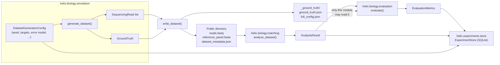
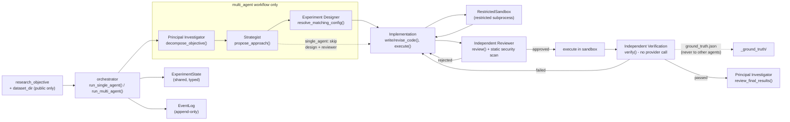

# HELIX Architecture

This document describes the system as it actually exists, and separates that clearly from
what is planned for later releases. See `docs/research_questions.md` for the scientific
motivation and `docs/benchmark_methodology.md` for how the benchmark is constructed.

## Status (Release 0.1)

| Component | Status |
|---|---|
| Synthetic dataset generator (`helix.biology.simulation`) | **Implemented** |
| Sequence mutation / distance utilities (`helix.biology.sequences`) | **Implemented** |
| FASTQ/FASTA I/O (`helix.io.fastq`) | **Implemented** |
| Deterministic matching baseline (`helix.biology.matching`) | **Implemented** |
| Independent ground-truth evaluator (`helix.biology.evaluation`) | **Implemented** |
| Experiment persistence (`helix.experiments.store`, SQLite) | **Implemented** |
| Pydantic config/result models (`helix.config.models`) | **Implemented** |
| Agent orchestration: PI, Strategist, Implementation, Reviewer, Experiment Designer, Verifier | **Implemented** |
| Shared `ExperimentState`, append-only event log, iteration/timeout budgets, cancellation | **Implemented** |
| Restricted-subprocess code execution for agent-written code | **Implemented** (not a hardened container - see `docs/security.md`) |
| Single-agent and multi-agent workflows | **Implemented** |
| LLM provider layer: deterministic `MockProvider` (default) + `AnthropicProvider` | **Implemented** (`AnthropicProvider` implemented but not yet run against a funded API key) |
| OpenAI-compatible / Gemini / Ollama providers | Not yet built |
| Parallel multi-agent workflow, controlled benchmark runner, ablations, repeated-run statistics | Not yet built |
| FastAPI backend / React frontend | Not yet built |

## Data flow (Release 0.1)

The arrow from `_ground_truth/` to the evaluator is intentionally the *only* path into that
directory anywhere in the codebase. `analyze_dataset()` takes a directory path and only ever
opens `reads.fastq` and `reference_panel.fasta` from it — it has no code path that could reach
`_ground_truth/`. This is an API-level and directory-level separation, not (yet) a hard
process/filesystem sandbox; that hardening is planned for the agent-execution phase, where
untrusted, model-generated code needs it far more than this trusted deterministic baseline does.

## Module responsibilities

- **`helix.config.models`** — every cross-module interface is a Pydantic model: generation
  config, reads, ground truth, matching config, analysis results, evaluation metrics, and the
  persisted experiment record. Nothing passes through the system as a loose dict.
- **`helix.biology.sequences`** — pure functions: random sequence generation, i.i.d.
  substitution/insertion/deletion mutation, Hamming and bounded edit distance, near-match
  variant construction (for building deliberately hard cases).
- **`helix.biology.simulation`** — turns a `DatasetGenerationConfig` into reads + ground truth
  deterministically (seeded `numpy.random.Generator`), and writes the public/private file split
  described above.
- **`helix.io.fastq`** — Biopython-backed FASTQ/FASTA read and write.
- **`helix.biology.matching`** — the conventional, non-LLM baseline: barcode-based duplicate
  collapsing, distance-based reference matching, frequency estimation, threshold-based detection.
- **`helix.biology.evaluation`** — the only module allowed to load a `GroundTruth`; scores a
  previously-produced `AnalysisResult` against it with fixed metric formulas.
- **`helix.experiments.store`** — SQLite-backed persistence of `ExperimentRecord`s, keyed so
  that every stored experiment can be reproduced from its saved `dataset_config` alone.
- **`helix.providers`** — `LLMProvider` interface; `MockProvider` (default, deterministic,
  offline) and `AnthropicProvider` (real, requires a separate API key) behind the same
  `complete(system, prompt) -> ProviderResponse` call.
- **`helix.agents`** — six role classes (`principal_investigator`, `strategist`,
  `experiment_designer`, `implementation`, `reviewer`, `verifier`), each with method
  signatures specific to its job, not a generic "chat" interface. `agents/base.py`'s
  `call_structured` is the one place prompts are built and JSON responses parsed back
  into Pydantic models.
- **`helix.orchestration`** — `messages.py` (typed agent-to-agent payloads), `state.py`
  (`ExperimentState`), `event_log.py` (append-only), `scheduler.py` (iteration/timeout
  budgets, cancellation), `orchestrator.py` (`run_single_agent` / `run_multi_agent`).
- **`helix.execution`** — `sandbox.py` (`RestrictedSandbox`, see `docs/security.md` for
  its honest scope) and `runner.py` (bridges the Implementation Agent's code to the
  sandbox and parses its declared `result.json` output contract).

## Agent orchestration layer

Every arrow into `IMPL` (write/revise code) and every call to `VER` goes through the
bounded `IterationBudget` / `CancellationToken` described in
`helix.orchestration.scheduler` - the diagram omits that control-flow wrapper for
readability, but no revision cycle in either workflow runs without it.

## Why the deterministic baseline still matters

The deterministic, non-LLM baseline from the scientific core (above) does not go away
now that agents exist - it is the fixed point every future agent configuration (both
workflows here, and whatever ablations/parallel variants come next) is compared
against. See `docs/benchmark_methodology.md` and `docs/agent_design.md` for how that
comparison is kept fair (same datasets, same independent evaluator, comparable
iteration/timeout budgets).
